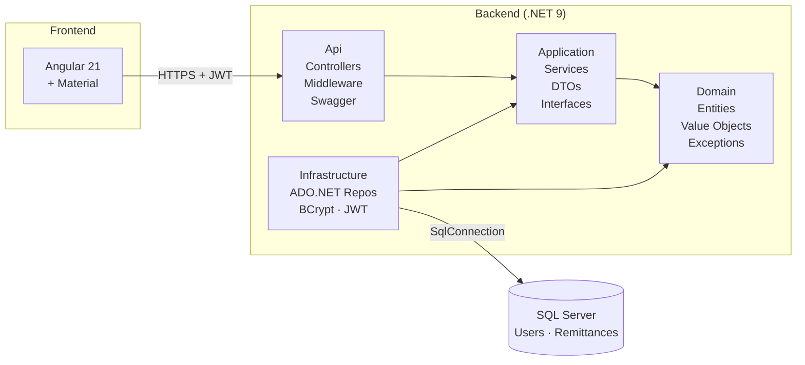

# RemittanceManager

Full-stack web app for managing remittances. Following **Clean Architecture** principles and **Test-Driven Development** (TDD).

> **Stack:** ASP.NET Core 9 Web API · ADO.NET (no ORM) · SQL Server scripts + stored procedures · JWT · Angular 21 · Angular Material · xUnit + FluentAssertions + Moq · Playwright

> **Constraint compliance:** No Entity Framework. No Dapper. No MediatR.

---

## Table of contents

1. [User story](#1-user-story)
2. [Architecture](#2-architecture)
3. [Project layout](#3-project-layout)
4. [Prerequisites](#4-prerequisites)
5. [Run locally (5 minutes)](#5-run-locally-5-minutes)
6. [Demo credentials](#6-demo-credentials)
7. [API surface](#7-api-surface)
8. [Testing](#8-testing)
9. [Design decisions](#9-design-decisions)

---

## 1. User story


**Short version:**

> **As an** administrator of remittances,
> **I want** a simple app where I can sign up, log in, and manage the list of remittances (including sender, beneficiary with their documents, amount, currency, and status),
> **so that** I can efficiently track, update, and maintain remittance records, ensuring data privacy, integrity, and that remittances already sent cannot be altered or deleted without proper authorization.

---

## 2. Architecture

The solution is a textbook **Clean Architecture** layout: dependencies always point inward, the Domain has zero external dependencies, and the API is the only assembly that knows about ASP.NET.



**Key rules enforced by project references:**

| Project | Depends on |
|---|---|
| `RemittanceManager.Domain` | *nothing* |
| `RemittanceManager.Application` | Domain |
| `RemittanceManager.Infrastructure` | Application, Domain |
| `RemittanceManager.Api` | Application, Infrastructure |

Business logic and validation live in **Application services** (`RemittanceService` orchestrates use cases, the status state machine, business-field locking on update, delete restrictions and ID-document validation). The **Domain** holds entities, enums and repository contracts. The **Infrastructure** layer is replaceable: swap SQL Server for Postgres by adding new `IUserRepository` / `IRemittanceRepository` implementations — no other project changes.

---

## 3. Project layout

```
RemittanceManager/
├─ src/
│  ├─ RemittanceManager.Domain/          # Entities, value objects, exceptions
│  ├─ RemittanceManager.Application/     # Services, DTOs, abstractions (IClock, IPasswordHasher, IJwtTokenGenerator)
│  ├─ RemittanceManager.Infrastructure/  # SqlConnectionFactory, ADO.NET repos, JWT
│  └─ RemittanceManager.Api/             # ASP.NET Core 9 host, controllers, middleware, Swagger
├─ tests/
│  ├─ RemittanceManager.Application.Tests/    # Pure unit tests with mocked dependencies
│  ├─ RemittanceManager.Infrastructure.Tests/ # SystemClock, BCrypt hasher, JWT token service
│  └─ RemittanceManager.Api.Tests/            # Controller tests with mocked application services
├─ frontend/
│  └─ src/app/
│     ├─ core/        # Services, interceptors, guards
│     ├─ features/    # auth/, remittances/
│     ├─ layout/      # shell.component
│     ├─ models/      # TS interfaces
│     └─ shared/      # confirm-dialog
├─ e2e/               # Playwright end-to-end tests
├─ playwright.config.ts
├─ package.json       # Playwright scripts only (e2e, e2e:headed, e2e:ui, e2e:report)
├─ global.json
└─ RemittanceManager.sln
```

---

## 4. Prerequisites

| Tool | Version used | Notes |
|---|---|---|
| .NET SDK | **9.0.312** | `global.json` pins the major version |
| Node.js | 20+ (tested on 25.2.1) | Angular CLI requires LTS in CI; odd versions emit a warning but work locally |
| npm | 11.x | Comes with Node |
| SQL Server | 2019 / 2022 (Developer or Express) | Local instance with **Windows Authentication** |

---


## 5. Run locally (5 minutes)

### 5.1 Create the database

Create a new SQL Server database named `RemittanceManager` on your local instance. You can do this using SQL Server Management Studio or with the following SQL command:

```sql
CREATE DATABASE RemittanceManager;
```

### 5.2 Configure the SQL Server connection

Edit [src/RemittanceManager.Api/appsettings.Development.json](src/RemittanceManager.Api/appsettings.Development.json) (or `appsettings.json`) and set `ConnectionStrings:DefaultConnection` to point to your local SQL Server instance and the `RemittanceManager` database. For example:

```json
"ConnectionStrings": {
    "DefaultConnection": "Server=YOUR_SERVER_NAME;Database=RemittanceManager;Trusted_Connection=True;TrustServerCertificate=True;Encrypt=False"
}
```

Replace `YOUR_SERVER_NAME` with the name of your local SQL Server instance.


### 5.3 Run database migrations and seed demo user

All database scripts and the demo user seed must be executed manually.

1. Apply all SQL scripts in order, located in `src/RemittanceManager.Infrastructure/Persistence/Scripts/`. These scripts create the tables and the stored procedures used by the application.
2. Run `004_SeedDemoUser.sql` after the schema scripts to insert the demo user and sample remittances.

### 5.4 Start the backend

Open a terminal and run:

```powershell
dotnet restore
dotnet build
dotnet run --project src/RemittanceManager.Api
```

The API will be available at:

- HTTP — http://localhost:5170
- HTTPS — https://localhost:7236
- Swagger UI — http://localhost:5170/swagger

### 5.5 Start the frontend

In another terminal:

```powershell
cd frontend
npm install
npm start
```

The Angular dev server will be at **http://localhost:4200**.

### 5.6 Open the app

Go to http://localhost:4200. The login form is pre-filled with the demo credentials; just click **Sign in**.

---

## 6. Demo credentials

| Field | Value |
|---|---|
| Email | `demo@remittance.test` |
| Password | `Demo123!` |
| Display name | `Demo User` |

Three sample remittances (Maria Castro · USD 250 · Completed; Carlos Perez · USD 120.50 · Sent; Ana Rodriguez · EUR 80 · Pending) are seeded for this user.

You can also register a new user from `/register` — the new account starts with an empty list.

---

## 7. API surface

All `/api/remittances/*` endpoints require a valid JWT (`Authorization: Bearer <token>`). `/api/auth/register` and `/api/auth/login` are anonymous. `/api/public/track/{code}` is also anonymous to demonstrate the **authorized vs. non-authorized** requirement.

| Method | Route | Auth | Description |
|---|---|---|---|
| `POST` | `/api/auth/register` | anon | Create a user. Returns `{ userId }`. The frontend then logs in automatically. |
| `POST` | `/api/auth/login` | anon | Returns `{ token, userId, email, displayName }`. |
| `GET` | `/api/public/track/{code}` | anon | Public tracking lookup by code (subset of fields, no PII beyond what the sender shares). |
| `GET` | `/api/remittances` | **JWT** | List **caller's** remittances only. |
| `GET` | `/api/remittances/{id:guid}` | **JWT** | Read one (404 if not owned). |
| `POST` | `/api/remittances` | **JWT** | Create. Server assigns `Id`, `TrackingCode`, `Date`, `Status=Pending`, `CreatedAtUtc`. Validates IDs by document type and `Amount > 0`. |
| `PUT` | `/api/remittances/{id:guid}` | **JWT** | Update. Enforces status state machine (Pending → Sent\|Cancelled; Sent → Completed\|Cancelled; Completed/Cancelled are terminal). When status ≠ Pending only `Status` can change — any business-field mutation returns 409. `Date` is immutable. |
| `DELETE` | `/api/remittances/{id:guid}` | **JWT** | Soft delete. Allowed only when `Status ∈ {Pending, Cancelled}`. Sent/Completed return 409. |

**Status codes used:** 200, 201 (+ Location), 204, 400 (validation, with `errors` dict), 401, 404 (not found / not owned), 409 (invalid state transition / locked field / forbidden delete), 500.

---

## 8. Testing

The project ships with **three** test stacks.

### 8.1 Backend unit tests (xUnit + FluentAssertions + Moq)

```powershell
dotnet test
```

| Project | What it covers |
|---|---|
| `RemittanceManager.Application.Tests` | Business services with mocked repos / clock / hasher / token service. Includes ownership checks, ID-document validation, status state machine, business-field locking on update, delete restrictions, password hashing flow, JWT issuance flow. |
| `RemittanceManager.Infrastructure.Tests` | `SystemClock`, `BCryptPasswordHasher`, `JwtTokenGenerator` (real cryptography, no mocks). |

### 8.2 Frontend unit tests (Vitest + Angular TestBed)

```powershell
cd frontend
npm test
```

Covers `AuthService`, `RemittancesService`, `authInterceptor` (Bearer header + 401 → logout), `authGuard` / `guestGuard`, and `LoginComponent` (validations, success path, error path).

### 8.3 End-to-end tests (Playwright)

```powershell
# headless (CI-friendly)
npm run e2e

# visible browser (demo)
npm run e2e:headed

# slower for human review (configurable via PW_SLOWMO env var, ms)
$env:PW_SLOWMO = 1000; npm run e2e:headed

# interactive UI mode (timeline, picker, snapshots)
npm run e2e:ui

# open last HTML report
npm run e2e:report
```

The 11 specs cover registration, login, invalid login, protected routes, session persistence, public tracking, state-machine behavior, logout, and create-then-delete a remittance. They hit the **real** Angular app, the **real** API and the **real** SQL Server.

> The Playwright VS Code extension (`ms-playwright.playwright`) is installed in this workspace — open the **Testing** view to run individual specs with one click.

### 8.4 Tests at a glance

| Layer | Framework | Count |
|---|---|---|
| Backend | xUnit + FluentAssertions + Moq | 59 (33 Application + 9 Infrastructure + 17 API) |
| Frontend unit | Vitest + Angular TestBed | 27 |
| E2E | Playwright + Chromium | 11 |
| **Total** | | **97** |

---

## 9. Design decisions

A few choices worth highlighting during the code review.

- **No ORM, no micro-ORM.** Repositories use `SqlCommand` with strictly parameterized queries — defends against SQL injection and keeps the data layer transparent.
- **SQL scripts + stored procedures.** The project intentionally demonstrates both database approaches: versioned `.sql` scripts create the schema/seed data, while remittance operations such as insert, list and soft delete are executed through stored procedures from the ADO.NET repository layer.
- **Database setup is explicit.** SQL scripts live in `src/RemittanceManager.Infrastructure/Persistence/Scripts/` and are applied manually in numeric order for a fresh database.
- **Repeatable demo seed.** `004_SeedDemoUser.sql` deletes the fixed demo records before inserting them again, so re-runs do not duplicate demo data.
- **JWT with HMAC-SHA256.** Symmetric key + issuer + audience + expiration in `appsettings.json`. The token includes `sub` (UserId), `email`, `name`. The Angular interceptor attaches it to every outgoing request.
- **Centralized error handling.** `ExceptionHandlingMiddleware` translates domain exceptions (`NotFoundException`, `ValidationException`, `UnauthorizedAccessException`, `ConflictException`) to RFC 7807 `ProblemDetails` (`{ title, status, detail, errors? }`) with the right status codes — controllers stay thin.
- **Status state machine + field locking.** Once a remittance leaves `Pending`, only `Status` can change and only along valid transitions (Pending → Sent\|Cancelled; Sent → Completed\|Cancelled). `Completed` and `Cancelled` are terminal. Soft delete is restricted to `Pending` and `Cancelled`. The frontend mirrors these rules visually (locked banner, filtered status dropdown, disabled delete button) but the backend is the source of truth.
- **Server-assigned operational fields.** `Id`, `TrackingCode`, `Status=Pending`, `Date` and `CreatedAtUtc` are set by the API on create — clients cannot spoof them. `Date` is immutable; `UpdatedAtUtc` is bumped on every successful update.
- **ID-document validation centralized.** `IdDocumentValidator` (Application layer) defines length and regex rules per `IdDocumentType` (CC, CE, Passport, DNI). Same rules are mirrored in the Angular form for UX, but the backend validates them on every Create / Update with `Status=Pending` to prevent bypass via curl/Postman.
- **Multi-tenant by `UserId`.** Every repository method takes a `userId` filter; controllers read it from `ClaimsPrincipal`. A user **cannot** read or modify another user's remittances by guessing a GUID — the repo returns `null`, the service throws `NotFoundException`, the API returns 404 (not 403, on purpose: it doesn't even acknowledge the resource exists).
- **DTOs are classes, not records.** Cleaner Swagger schemas, easier serialization defaults, and no risk of value-equality surprises in tests.
- **Primary constructors** for backend services keep the wiring single-line where possible.
- **Functional Angular** — standalone components, signals (`signal`, `computed`), new control flow (`@if`, `@for`), functional interceptor (`HttpInterceptorFn`) and functional guards (`CanActivateFn`).
